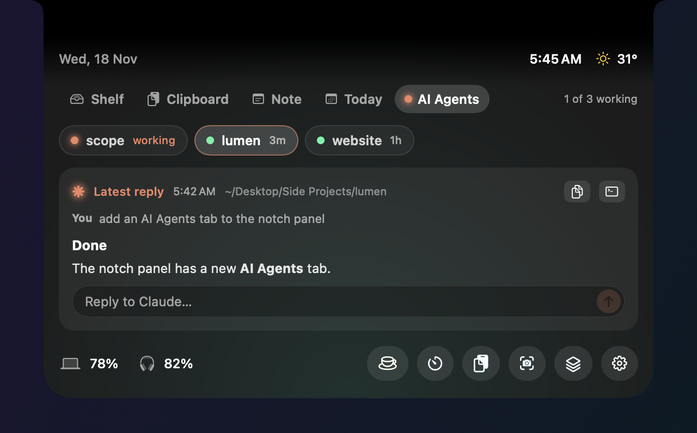
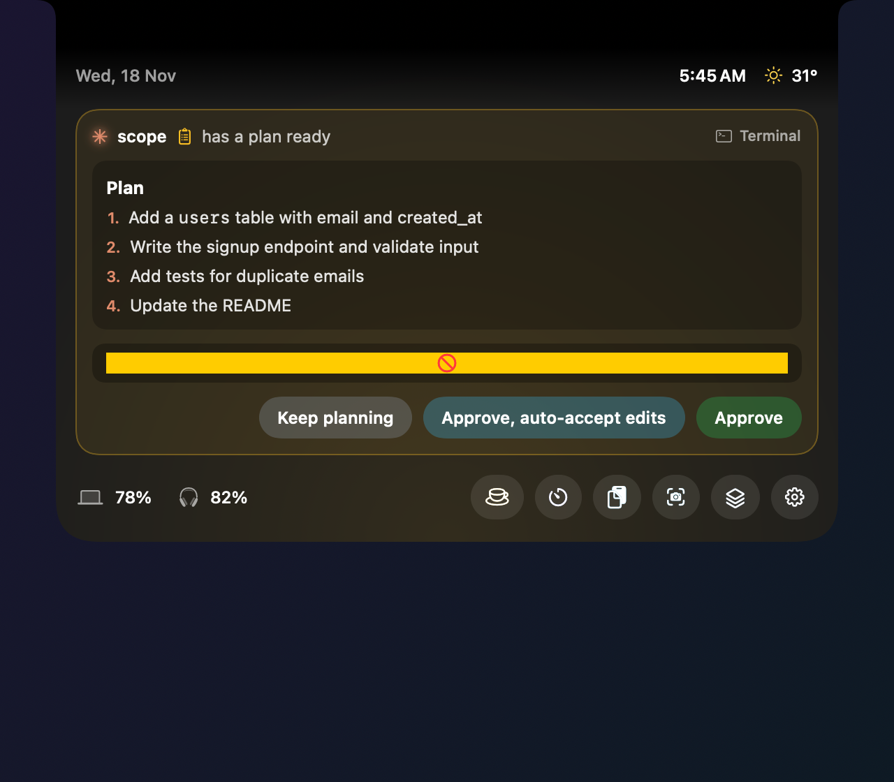
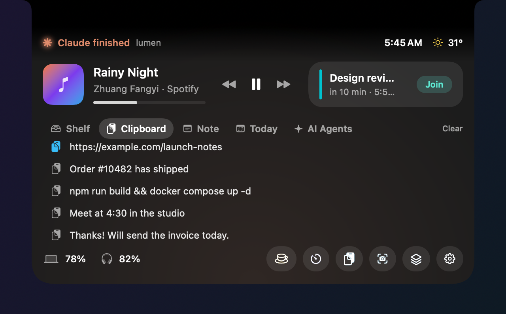
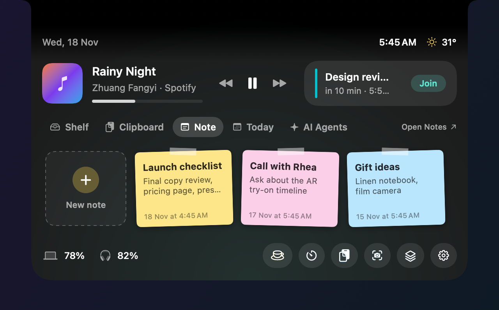

# Lumen

**The notch was dead space. Now it's the busiest few pixels on your Mac.**

Point at it and it opens into a sheet of dark glass that knows what's playing, what's next, what you just copied and what Claude is waiting on. Move away and it's a notch again.

*Designed and built by **Samay Wadhwani***

 

### [Download Lumen for Mac](https://github.com/SamayW/lumen-releases/releases/latest/download/Lumen.zip)

Free · macOS 14 or newer · Apple Silicon and Intel · updates itself

 

---

## A day with Lumen

**08:58** · A meeting starts in two minutes. The closed notch has been counting it down at the edge of your eye. Point at it and press **Join**.

**10:14** · You take a screenshot. Lumen catches it on the **Shelf** and opens there, so you can drag it straight into Slack, AirDrop it, mark it up or copy the text out of it.

**11:30** · A YouTube video is playing in your browser. It shows up in the notch the same way Spotify or Apple Music would: title, channel, a progress bar and controls. The panel's glow takes on the album art's colour.

**13:05** · Claude Code wants to run `pnpm test`. A card drops out of the notch showing the exact command, with **Allow**, **Always allow** and **Deny with a reason** next to it. If Claude is asking a question instead, you get the choices as buttons. If it's a plan, you can read it and approve it there.

**15:40** · You've copied ten things since lunch. The **Clipboard** tab still has all of them (password managers are skipped).

**17:20** · You turn the volume up. The level grows out of the notch, not Apple's pop-up in the corner.

**18:00** · A thought you don't want to lose goes into **Note**. It's saved to Apple Notes, so it's on your iPhone too.

Then ⌥Space, Esc, and the notch is quiet again.

| | |
|---|---|
|  |  |
|  |  |

---

## What's inside

<table>
<tr><td width="50%" valign="top">

**The panel**
- Now playing from anything: YouTube in any browser, Spotify, Apple Music, podcasts
- Your next meeting, with a Join button and a countdown
- **Shelf** for screenshots, downloads and anything you drop on it
- **Clipboard**: your last 10 copies
- **Note**: sticky cards that save to Apple Notes
- **Today**: the rest of your day on a timeline, with the free gaps marked
- Keep Awake, focus timer, weather, Mac and AirPods battery

</td><td width="50%" valign="top">

**For people who work with Claude Code**
- **AI Agents**: every running session as a pill. Read its latest reply and answer it without leaving what you're doing
- **Prompt cards** that fit the ask: commands as code, file edits as a diff, questions as choices, plans with Approve / Keep planning
- "Claude needs you" and "Claude finished" in the closed notch

**And the small things**
- Volume and brightness in the notch
- ⌥Space from anywhere, 1–5 for tabs, Esc to close
- Compact mode for 13-inch screens
- Follows your mouse across two displays

</td></tr>
</table>

---

## Install in two minutes

1. **[Download Lumen.zip](https://github.com/SamayW/lumen-releases/releases/latest/download/Lumen.zip)**, unzip it and open the **Lumen** folder.
2. Double-click **Install Lumen.command**.
   If macOS says it "cannot be verified", open **System Settings › Privacy & Security**, scroll down, click **Open Anyway**, then double-click the installer again.
3. In the **Lumen Setup** window, click **Set Everything Up**. Then point at the notch.

Everything else lives in **Settings**: the gear in the panel, or open Lumen again. To answer Claude Code from the notch, go to **Settings › Permissions › Connect**.

The full Liquid Glass look needs macOS 26 Tahoe; older versions get a solid dark panel. On a Mac without a notch, Lumen sits at the top centre of the screen.

---

## Quiet by design

Lumen does nothing while you're not looking at it. At rest it uses about **0% CPU**: it waits for your mouse instead of watching it, and the glass only renders while the panel is open.

It also keeps itself up to date. When a new version is out, an **Update** button appears at the top of the panel. One click and Lumen checks the download is a genuine release, installs it and relaunches. Every version is listed under **[Releases](https://github.com/SamayW/lumen-releases/releases)**.

Something not right? Open **Settings › About › Report a Problem…**. It copies a report you can read before you send it, and nothing leaves your Mac unless you paste it somewhere.

**Uninstall:** right-click the panel › Quit Lumen, then delete `~/Applications/Lumen.app`.

---

**Lumen** is designed and built by **[Samay Wadhwani](https://github.com/SamayW)**.
Also by Samay: **[Glow Dock](https://github.com/SamayW/glow-dock)**, the matching glow-glass Dock.

© 2026 Samay Wadhwani · <a href="LICENSE">License</a>

