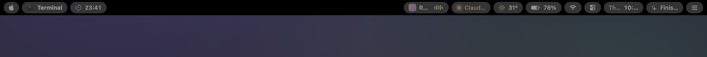
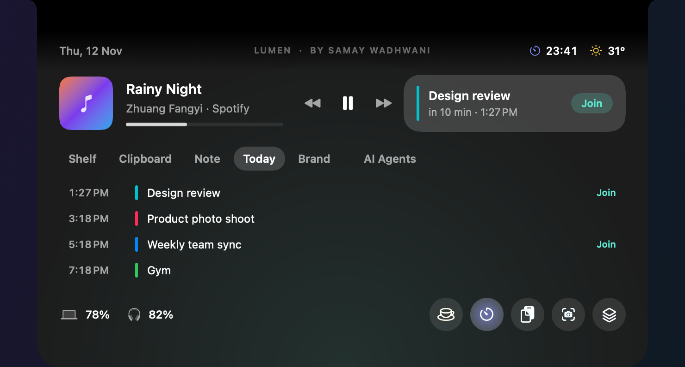
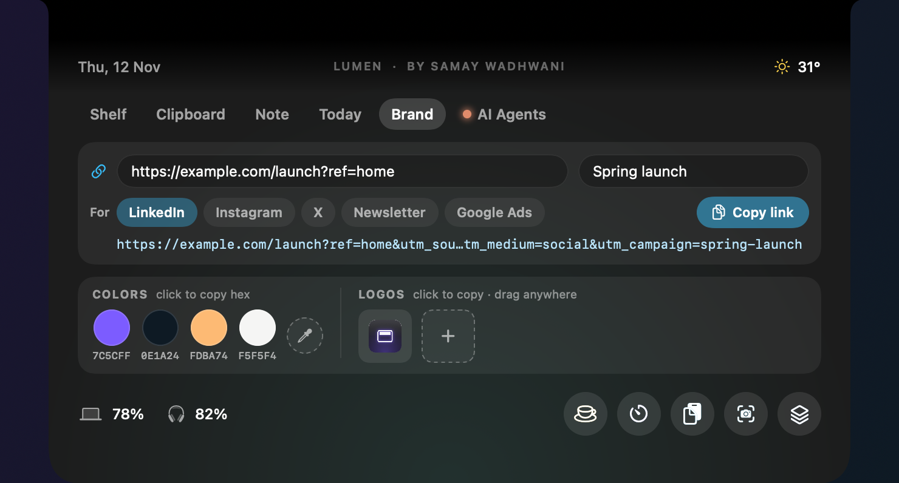

# Lumen

A dark, minimal **Liquid Glass** panel that lives in your Mac's notch, plus the **Lumen Bar**, a glass menu bar built around it.

Designed and developed by **Samay Wadhwani**.

**[⬇ Download the latest Lumen.zip](https://github.com/SamayW/lumen-releases/releases/latest/download/Lumen.zip)**

| | |
|---|---|
|  |  |
|  |  |

## Install (2 minutes)

1. Download **Lumen.zip** (link above), unzip it and open the **Lumen** folder.
2. Double-click **Install Lumen.command**.
   If macOS says it "cannot be verified" (it isn't from the App Store): open **System Settings → Privacy & Security**, scroll down, click **Open Anyway**, then double-click the installer again.
3. Answer the questions, then point at the notch.
4. In the **Lumen Setup** window, click **Set Everything Up**. You can reopen it any time: right-click the Lumen Bar → Lumen Setup…

**Needs** macOS 14 Sonoma or newer, Apple Silicon or Intel. The full glass look needs macOS 26 Tahoe; older versions get a solid dark panel. On Macs without a notch it sits at the top centre of the screen.

## What it does

**The notch panel.** Point at the notch and it grows into a glass panel.
- Now playing (Spotify / Apple Music) with controls
- Your next meeting with a Join button, plus today's schedule
- **Shelf**: screenshots land there, drop any file to park it, drag it out anywhere. Copy text from an image, AirDrop, mark up
- **Clipboard** history (password managers skipped)
- **Note**: quick notes saved to Apple Notes, kept as sticky cards
- Focus timer, Keep Awake, weather, Mac and AirPods battery

**For developers: AI Agents.**
- Every running Claude Code session as a pill. Tap one to read its latest reply
- Reply to a session right from the notch (Terminal / iTerm)
- Answer Claude Code permission prompts with **Allow / Deny** from the notch
- Alerts when Claude needs you or finishes

**For marketers: Brand.**
- Tracked links: paste a URL, pick LinkedIn, Instagram, X, Newsletter or Google Ads, copy the link with UTM tags filled in
- Brand kit: colours (eyedropper, click to copy hex) and logos (click to copy, drag into any app)

**The Lumen Bar.** Glass pills either side of the notch that replace Apple's menu bar: the front app's menus, Wi-Fi, battery, clock and calendar, Control Center, weather, music. Right-click it → Customize Lumen Bar…

**Two displays?** The notch follows your mouse. Right-click the panel → Show Notch On to pin it to one display.

## Updates

Install once, and Lumen keeps itself up to date. When a new version is out, a green **Update to x.y** button appears at the top of the panel: click it and Lumen downloads, installs and relaunches. Right-click the panel → **Check for Updates…** to check now. (After an update, macOS may ask for Accessibility again.)

Every version is listed under [Releases](https://github.com/SamayW/lumen-releases/releases).

## Uninstall

Right-click the panel → Quit Lumen, then delete `~/Applications/Lumen.app`.

---

© 2026 Samay Wadhwani. All rights reserved.
